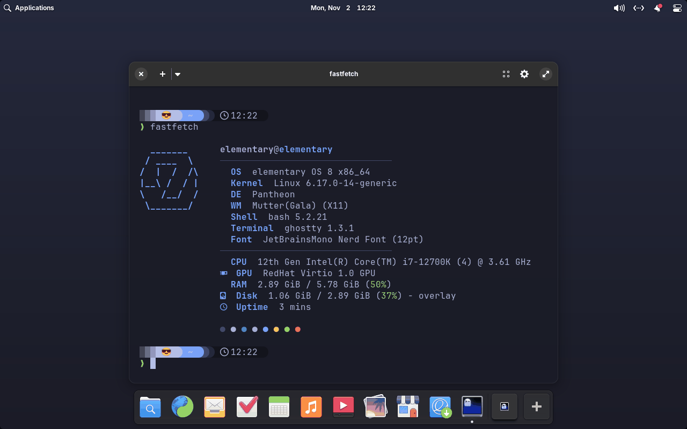
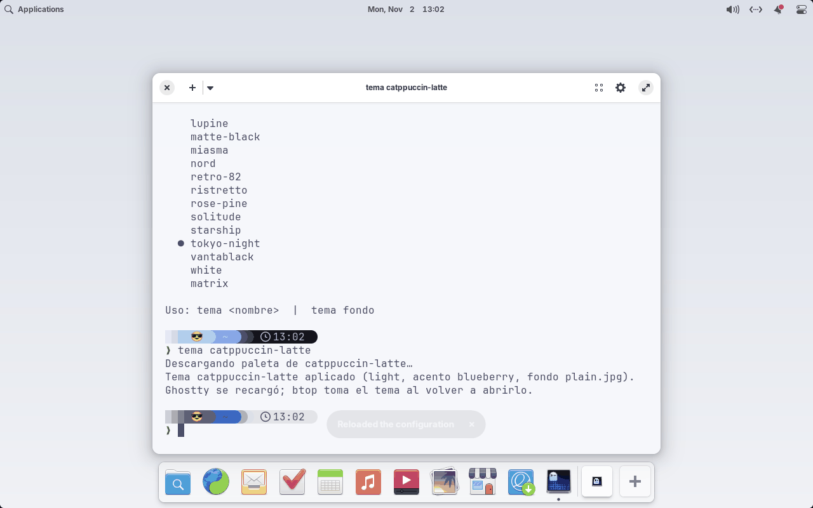
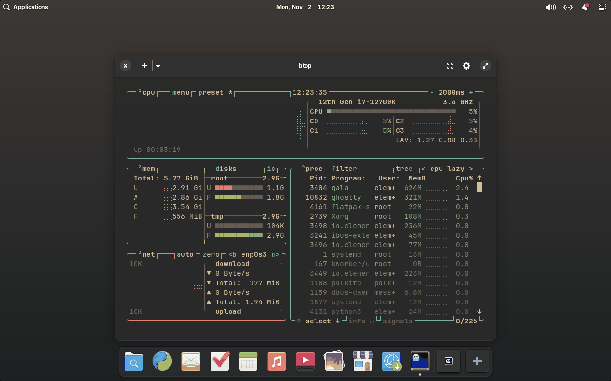
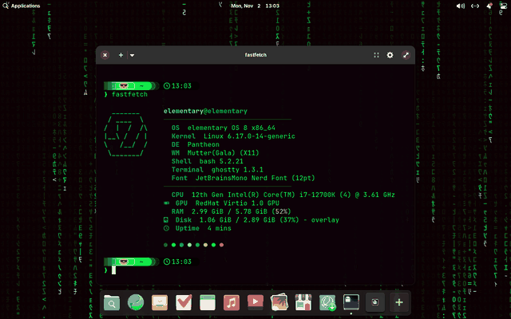

# pantheme

[](https://github.com/sponsors/sawady)

[English](README.md) · Español

Instalador por pasos para **elementary OS 8** (Pantheon, X11): terminal
moderna, un cambiador de temas de un solo comando y atajos de teclado,
**inspirado en [Omarchy](https://omarchy.org)**, sin reemplazar el escritorio de
elementary.

- Terminal **Ghostty** con JetBrains Mono Nerd Font y prompt **Starship**.
- Herramientas: eza, bat, fzf, zoxide, btop, fastfetch, lazygit, lazydocker.
- **`tema`**: cambia todo el aspecto (terminal, prompt, btop, Zed, fondo,
  acento de Pantheon, claro/oscuro) con un comando, usando las paletas y
  fondos de los temas de Omarchy, más temas propios (como **Matrix**, con fondo
  animado).
- Atajos de teclado al estilo Omarchy (Super+Enter, Super+W, Super+1–9…).
- Todo se puede **deshacer**: `./install.sh desinstalar`.

## Capturas



`tema` cambiando a Catppuccin Latte (claro), btop con Gruvbox y el tema
Matrix con su fondo animado:







Sacadas en una VM de elementary OS 8.1 con `tests/vm/run.py`. Usan fondos
lisos en lugar de los de Omarchy, que `tema` descarga pero no tienen licencia
por imagen.

## Requisitos

elementary OS 8 en sesión **X11**, x86_64, internet y `sudo` (sólo para apt).

## Instalación

```bash
sudo apt install -y git         # elementary OS no lo trae
git clone https://github.com/sawady/pantheme.git ~/pantheme
cd ~/pantheme
./install.sh                    # pasos por defecto
./install.sh todo zed fondos    # por defecto + algunos opcionales
./install.sh atajos             # o sólo algunos pasos
```

| Paso | Qué hace |
|---|---|
| `paquetes` | apt: btop, eza, bat, fzf, zoxide, python3-pil y básicos |
| `ghostty` | Instala Ghostty con [ghostty-ubuntu](https://github.com/mkasberg/ghostty-ubuntu), si falta |
| `binarios` | Starship, fastfetch, lazygit, lazydocker, `tema` y la fuente en `~/.local` |
| `configs` | Copia `config/` a `~/.config` y los temas propios a `~/.local/share/tema` |
| `shell` | Agrega a `~/.bashrc` la línea que carga `omarchy-style.sh` |
| `escritorio` | Ghostty como terminal por defecto y en el dock (en lugar de la Terminal; el resto del dock queda igual) |
| `atajos` | Atajos de teclado |
| `tema` | Aplica Tokyo Night (`TEMA_INICIAL=<tema>` para otro) |

Opcionales (sólo si se nombran): `zed` (tema Matrix y ajustes de Zed),
`fondos` (rotación del fondo cada 30 min con un timer de systemd), `animado`
(fondo animado para los temas que lo tienen, al iniciar sesión).

## Desinstalación

```bash
./install.sh desinstalar              # todo
./install.sh desinstalar atajos zed   # sólo algunos pasos
```

El instalador registra cada archivo que escribe en
`~/.local/state/pantheme/manifest`, guarda los originales en
`backup/` y anota el valor previo de cada ajuste de gsettings que cambia. Al
desinstalar repone los originales (o saca lo nuestro, moviéndolo a
`desinstalado-<fecha>/`), quita la línea de `~/.bashrc`, restaura dock,
terminal, atajos, acento, modo y fondo, desactiva el timer y el servicio del
fondo animado, y borra binarios y fuente de `~/.local`.

No se deshace: paquetes de apt y Ghostty (se imprime cómo quitarlos), fondos
descargados y `~/.config/zed/settings.json`. Si instalaste antes de que
existiera el registro, corré `./install.sh` una vez más con los mismos pasos y
después desinstalá.

### Si venís de `elementary-setup`

El proyecto antes se llamaba `elementary-setup`. Lo instalado no depende de
dónde esté el clon, así que alcanza con moverlo:

```bash
mv ~/elementary-setup ~/pantheme
git -C ~/pantheme remote set-url origin https://github.com/sawady/pantheme.git
git -C ~/pantheme pull
```

La próxima vez que corras `./install.sh` (cualquier paso, o `desinstalar`)
mueve el registro de `~/.local/state/elementary-setup/` a
`~/.local/state/pantheme/`, así lo instalado con el nombre viejo se puede
seguir desinstalando.

## `tema`

```bash
tema                 # tema actual + lista
tema catppuccin      # aplicar (lo descarga la primera vez)
tema fondo           # siguiente fondo
tema animado on|off  # fondo animado, si el tema tiene
```

Un tema propio es una carpeta con `colors.toml` (formato de Omarchy, con una
tabla `[starship]` opcional), `fondos/*.jpg` y, si se quiere, un ejecutable
`animado`.

## Pruebas

Además del smoke test en contenedor que corre el CI, `tests/vm/run.py test`
arranca el ISO oficial de elementary OS 8 en una VM (QEMU/KVM dentro de
Docker), instala todo, verifica los ajustes del escritorio, cambia de tema,
desinstala y compara con el estado inicial. Se corre a mano; ver
[CONTRIBUTING.md](CONTRIBUTING.md#testing). Cambios:
[CHANGELOG.md](CHANGELOG.md) y [BITACORA.md](BITACORA.md).

Atajos, alias de terminal, estructura y desarrollo: ver el
[README en inglés](README.md).

## Créditos

No está afiliado a Omarchy, Basecamp ni elementary, Inc. Las paletas y fondos
de [Omarchy](https://github.com/omacom/omarchy) (MIT, David Heinemeier Hansson)
se descargan al usar `tema`; no están en este repo y los **fondos son de sus
autores**. `config/starship.toml` parte del preset Tokyo Night de Starship
(ISC). El tema Matrix y su fondo animado son propios. Detalle en el
[README en inglés](README.md#credits).

## Apoyar el proyecto

pantheme es software libre. Si te resulta útil, podés apoyar su desarrollo con
[GitHub Sponsors](https://github.com/sponsors/sawady).

## Licencia

[MIT](LICENSE) © Federico A. Sawady O'Connor
