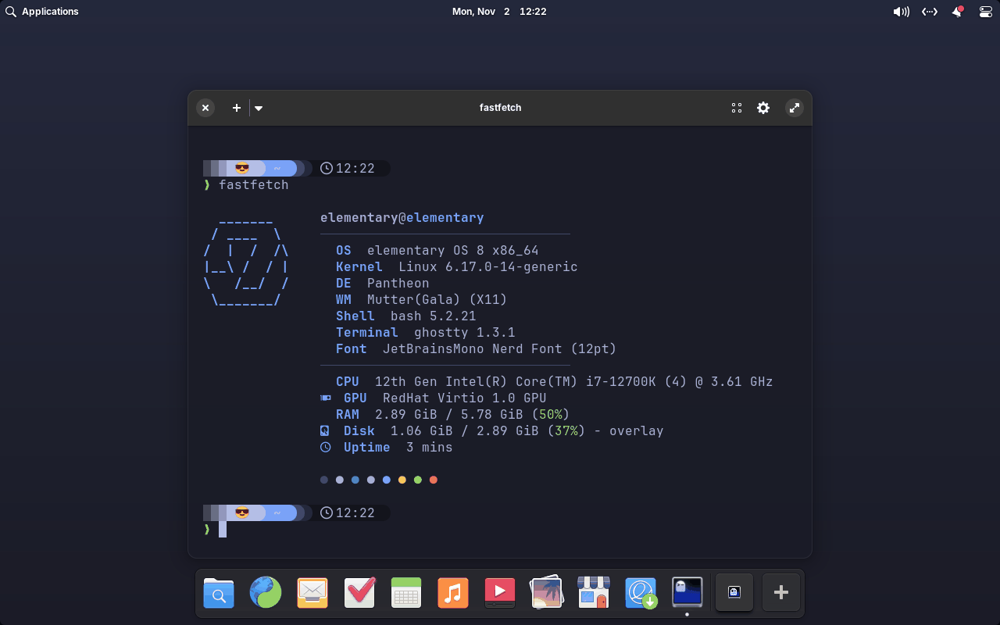
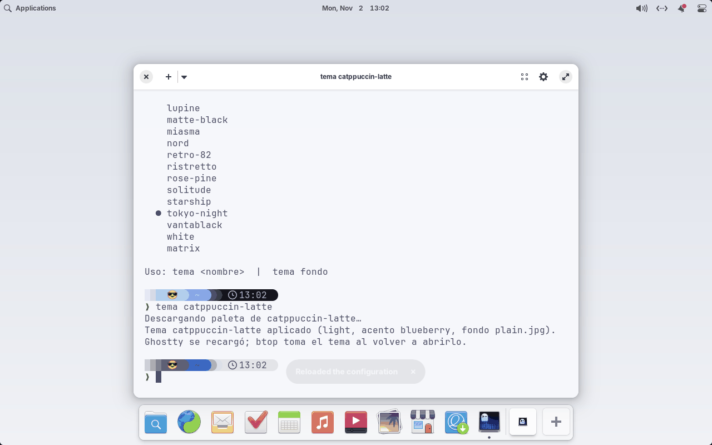
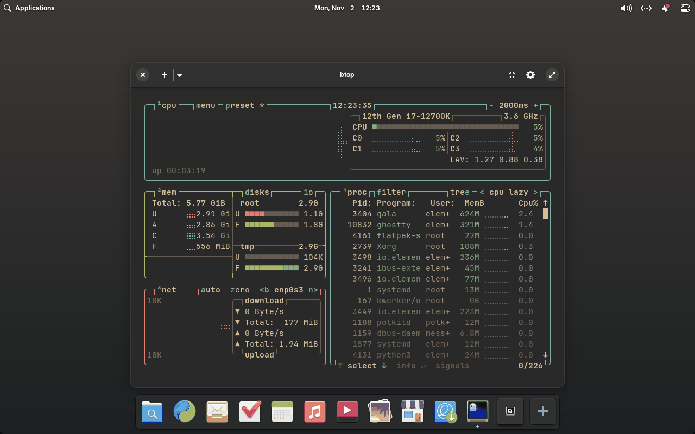
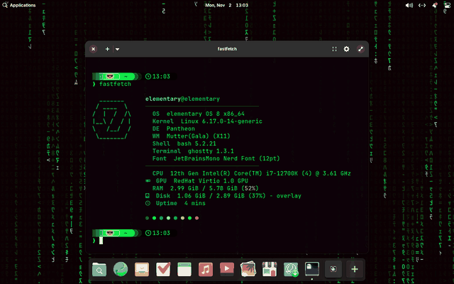

# pantheme

[](https://github.com/sponsors/sawady)

English · [Español](README.es.md)

A step-by-step setup for **elementary OS 8** (Pantheon, X11) that gives you a
modern terminal, a one-command theme switcher and keyboard-driven window
management, **inspired by [Omarchy](https://omarchy.org)**, without replacing
the elementary desktop.

- **Ghostty** terminal with JetBrains Mono Nerd Font and a **Starship** prompt.
- Modern CLI tools: eza, bat, fzf, zoxide, btop, fastfetch, lazygit, lazydocker.
- **`tema`**: switch the whole look (terminal, prompt, btop, Zed, wallpaper,
  Pantheon accent, light/dark) with one command, using the color palettes and
  wallpapers of Omarchy's themes, plus themes of its own (like an animated
  **Matrix** theme).
- Keyboard shortcuts in the Omarchy spirit (Super+Enter, Super+W, Super+1–9…).
- Every step can be **undone**: `./install.sh desinstalar`.

> **Note:** step names and messages are in Spanish for now (`paquetes`,
> `desinstalar`, `tema fondo`…). The tables below translate them.

## Screenshots

Ghostty with Starship and fastfetch, Tokyo Night (the default theme):



`tema` lists the themes and switches to Catppuccin Latte: Ghostty reloads,
the prompt, the accent color, light mode and the wallpaper follow:



btop with Gruvbox:



The bundled Matrix theme, with the animated wallpaper:



Taken on an elementary OS 8.1 VM by `tests/vm/run.py`. They show plain
wallpapers instead of Omarchy's, which `tema` downloads but which don't come
with per-image licenses (see [Credits](#credits)).

## Requirements

- elementary OS 8 (Ubuntu 24.04 base) on an **X11** Pantheon session.
- x86_64 (the downloaded binaries are amd64 builds).
- Internet access and `sudo` (only for `apt`).

## Install

```bash
sudo apt install -y git         # elementary OS doesn't ship it
git clone https://github.com/sawady/pantheme.git ~/pantheme
cd ~/pantheme
./install.sh                    # default steps
./install.sh todo zed fondos    # default steps + some optional ones
./install.sh atajos             # or just some steps
./install.sh --help
```

### Steps

Default steps (what `./install.sh` and `./install.sh todo` run):

| Step | What it does |
|---|---|
| `paquetes` | apt: btop, eza, bat, fzf, zoxide, python3-pil and a few basics |
| `ghostty` | Installs Ghostty with the [ghostty-ubuntu](https://github.com/mkasberg/ghostty-ubuntu) installer, if it's missing |
| `binarios` | Starship, fastfetch, lazygit, lazydocker, `tema` and JetBrains Mono Nerd Font into `~/.local` (latest GitHub releases) |
| `configs` | Copies `config/` into `~/.config` and the bundled themes into `~/.local/share/tema` |
| `shell` | Adds one line to `~/.bashrc` that loads `~/.config/bash/omarchy-style.sh` |
| `escritorio` | Ghostty as default terminal and in the dock (replaces elementary's Terminal there; other launchers are kept) |
| `atajos` | Keyboard shortcuts (see below) |
| `tema` | Applies Tokyo Night with `tema` (set `TEMA_INICIAL=<theme>` to start with another one) |

Optional steps (only when you name them):

| Step | What it does |
|---|---|
| `zed` | Matrix theme for Zed, and the theme settings in `~/.config/zed/settings.json` if that file doesn't exist yet |
| `fondos` | systemd user timer that rotates the wallpaper every 30 minutes |
| `animado` | Animated wallpaper for themes that have one (Matrix), started at login |

## Uninstall

```bash
./install.sh desinstalar              # undo everything
./install.sh desinstalar atajos zed   # or only some steps
```

The installer records every file it writes in
`~/.local/state/pantheme/manifest` and keeps the files it replaced in
`~/.local/state/pantheme/backup/`. It also saves the previous value of
every desktop setting (gsettings) it changes. Uninstalling:

- restores the original files, or removes ours if there was none (removed
  files are moved to `~/.local/state/pantheme/desinstalado-<date>/`,
  not deleted);
- removes the line from `~/.bashrc`;
- restores the dock, default terminal, shortcuts, accent, light/dark mode and
  wallpaper to their previous values;
- disables the systemd timer and the animated wallpaper service;
- removes the binaries and the font from `~/.local`.

Not undone: apt packages and Ghostty (other programs may use them; the command
to remove them is printed), downloaded wallpapers in `~/Pictures/Wallpapers`,
and `~/.config/zed/settings.json`.

To reset only the shortcuts to elementary's factory defaults:
`./gsettings/atajos.sh --restaurar`.

> Installed before the uninstaller existed? Run `./install.sh` once more with
> the steps you used; it registers the existing install (using the oldest
> `~/.config-backup-*` as the original) and then `desinstalar` works.

### Migrating from `elementary-setup`

This project used to be called `elementary-setup`. Nothing installed depends
on where the repository is cloned, so an existing clone can just be moved:

```bash
mv ~/elementary-setup ~/pantheme
git -C ~/pantheme remote set-url origin https://github.com/sawady/pantheme.git
git -C ~/pantheme pull
```

The next time you run `./install.sh` (any step, or `desinstalar`), it moves
the old record from `~/.local/state/elementary-setup/` to
`~/.local/state/pantheme/`, so everything installed under the old name can
still be uninstalled. Installs older than the record itself: see the note
above.

## `tema`, the theme switcher

```bash
tema                 # current theme + list
tema catppuccin      # apply a theme (downloads it the first time)
tema fondo           # next wallpaper of the current theme
tema animado on|off  # animated wallpaper, for themes that have one
```

`tema` downloads the palette (`colors.toml`) and wallpapers of Omarchy's
themes from GitHub and applies them to: Ghostty (open windows reload), the
Starship palette, btop, Zed (when there's an equivalent theme), the wallpaper,
the Pantheon accent color and light/dark mode.

Wallpapers go to `~/Pictures/Wallpapers/<theme>/` (or `$TEMA_WALLPAPERS`).
Set `GITHUB_TOKEN` if you hit GitHub's API rate limit.

### Bundled themes

- **`matrix`**: phosphor green on black, a Zed theme and an **animated
  wallpaper** of katakana rain (`temas/matrix/animado`, Python + GTK3 + cairo,
  ~7% of one core at 15 fps; tune with `MATRIX_FPS` and `MATRIX_SIZE`). Needs
  the `animado` step.

A theme is a folder with `colors.toml` (same format as Omarchy's, plus an
optional `[starship]` table), `fondos/*.jpg` and, optionally, an executable
`animado`. Put it in `temas/` and run `./install.sh configs`, or drop it into
`~/.local/share/tema/<name>/`.

## Terminal

| Command | What it does |
|---|---|
| `ls` `ll` `la` `lt` | eza with icons and git (`lt` = tree) |
| `cat` | bat with syntax highlighting |
| `Ctrl+R` `Ctrl+T` `Alt+C` | fzf: history, files, directories |
| `ff` | fzf with preview |
| `z <dir>` / `cd` | zoxide |
| `top` `fetch` `lg` `lzd` | btop, fastfetch, lazygit, lazydocker |

fzf, lazygit and lazydocker use ANSI colors, so they follow Ghostty's theme.

## Keyboard shortcuts

| Shortcut | Action |
|---|---|
| Super+Enter / Super+T | Ghostty |
| Super+W / Alt+F4 | Close window |
| Super+F | Fullscreen |
| Super+Shift+P | Picture in picture |
| Super+1–9 | Go to workspace N |
| Super+Shift+1–9 | Move window to workspace N |
| Super+Alt+1–9 | Open dock app N |
| Super+Shift+B | Browser |
| Super+Shift+F | Files |
| Super+Escape / Super+L | Lock screen |
| Super+Space | App launcher (unchanged) |

## Manual tweaks (can't be automated)

- **Chrome**: install a Tokyo Night theme from the Chrome Web Store, or
  *Customize Chrome* → color `#1a1b26`.

## Repository layout

```
install.sh                    step-by-step installer (and uninstaller)
bin/tema                      theme switcher (Python)
temas/<name>/                 bundled themes (colors.toml, animado, fondos)
config/                       files that go into ~/.config
gsettings/escritorio.sh       dock, default terminal
gsettings/atajos.sh           shortcuts (--claves, --restaurar)
capturar.sh                   copy your machine's configs back into the repo
tests/smoke.sh                smoke test for CI (run it in a container only)
tests/vm/                     end-to-end test on an elementary OS VM (run.py)
```

## Development

- `./capturar.sh` copies your current configs back into the repo; then review
  with `git diff`. (It also captures the Starship palette of your current
  theme; the repo keeps Tokyo Night's.)
- CI runs shellcheck, `py_compile` and `tests/smoke.sh` in an `ubuntu:24.04`
  container. To run the smoke test locally:
  `docker run --rm -v "$PWD":/src:ro ubuntu:24.04 bash /src/tests/smoke.sh`.
- `tests/vm/run.py test` boots the official elementary OS 8 ISO in a QEMU/KVM
  VM (inside Docker), installs everything, checks the desktop settings,
  switches themes, uninstalls and compares with the initial state. It's run
  by hand, not in CI; see [CONTRIBUTING.md](CONTRIBUTING.md#testing).
- [CHANGELOG.md](CHANGELOG.md); development log with the reasoning behind
  each decision (in Spanish): [BITACORA.md](BITACORA.md).

## Credits

This project is not affiliated with Omarchy, Basecamp or elementary, Inc.

- [Omarchy](https://github.com/omacom/omarchy) by David Heinemeier Hansson
  (MIT): the inspiration, and the source of the theme palettes and wallpapers
  that `tema` downloads at runtime. They are not included in this repository.
  The **wallpapers belong to their respective artists**; Omarchy distributes
  them without per-image licenses, so use them for personal use only.
- [Starship](https://starship.rs) Tokyo Night preset (ISC), the base of
  `config/starship.toml`.
- [Tokyo Night](https://github.com/enkia/tokyo-night-vscode-theme) by enkia
  (MIT), the default palette.
- Installed tools, each under its own license: Ghostty (MIT), Starship (ISC),
  fastfetch (MIT), lazygit (MIT), lazydocker (MIT), JetBrains Mono (OFL-1.1)
  patched by Nerd Fonts, and from Ubuntu: btop (Apache-2.0), eza (EUPL-1.2),
  bat (MIT/Apache-2.0), fzf (MIT), zoxide (MIT). Ghostty is installed with
  [mkasberg/ghostty-ubuntu](https://github.com/mkasberg/ghostty-ubuntu).
- The Matrix theme and its animated wallpaper are original work, a homage to
  the film; "The Matrix" is a trademark of Warner Bros.

## Sponsoring

pantheme is free software. If it is useful to you, you can support its development through
[GitHub Sponsors](https://github.com/sponsors/sawady).

## License

[MIT](LICENSE) © Federico A. Sawady O'Connor
